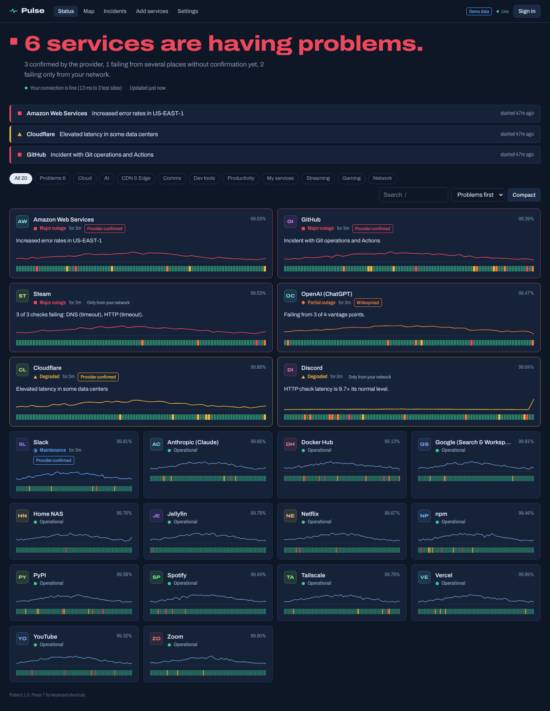
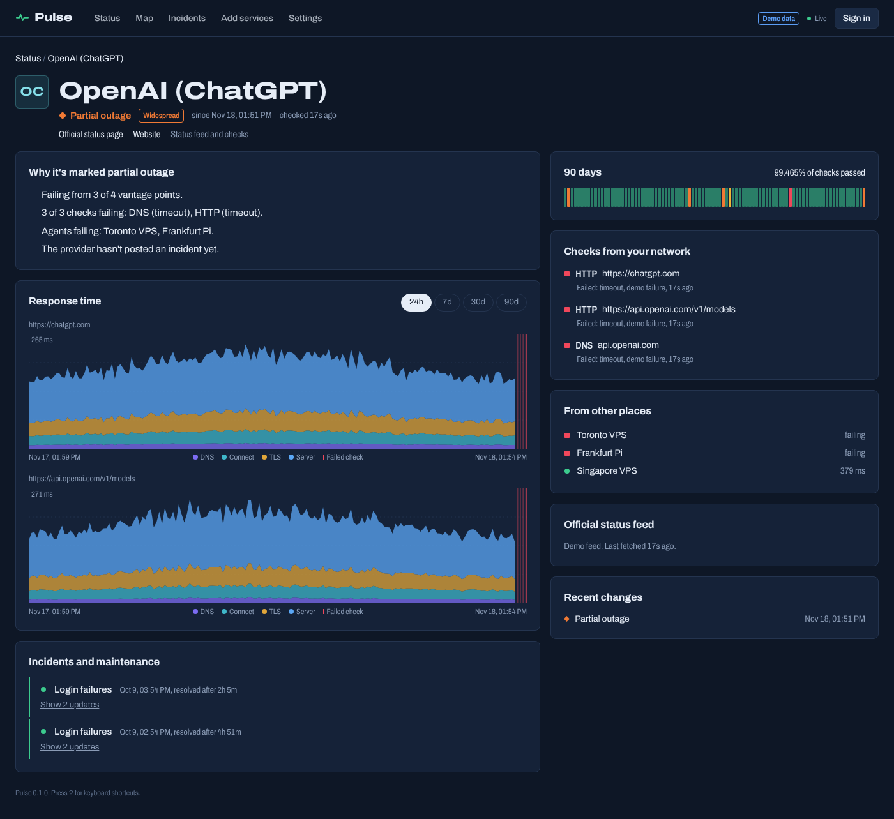
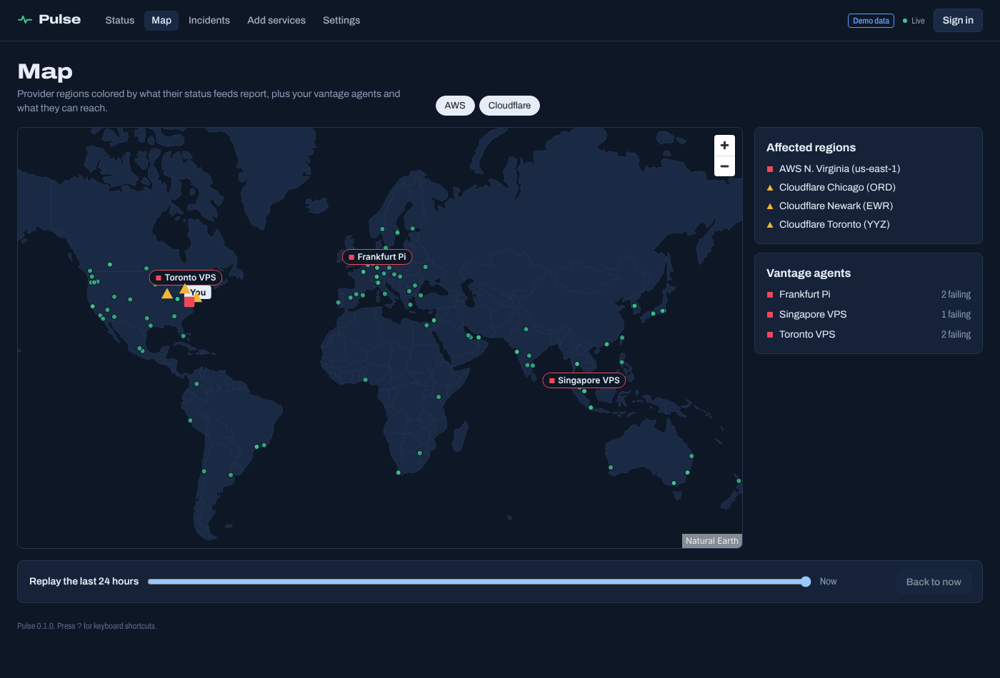
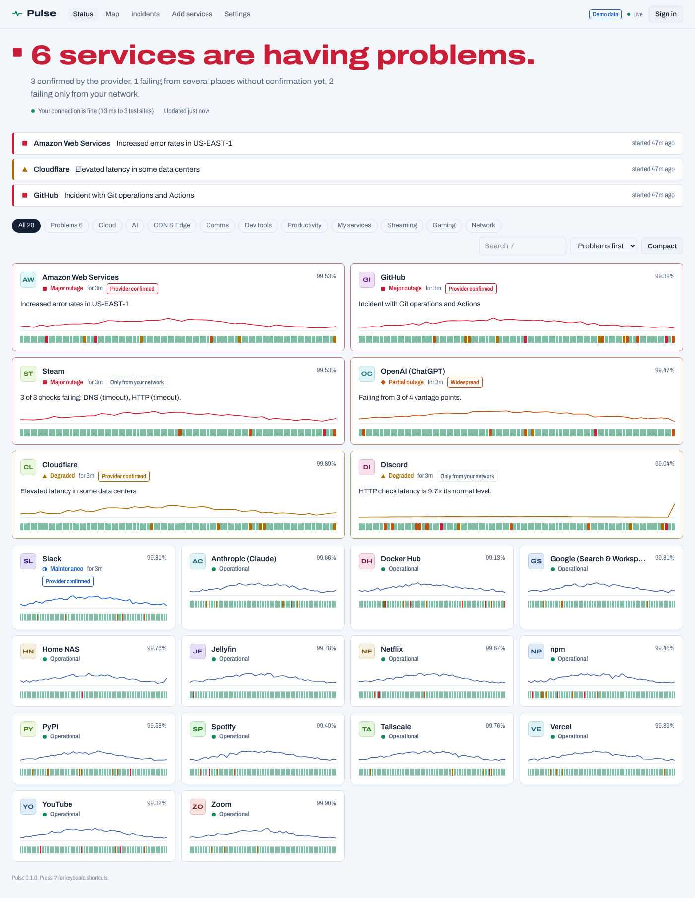
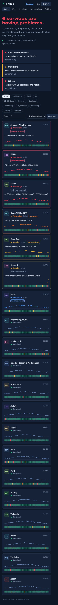
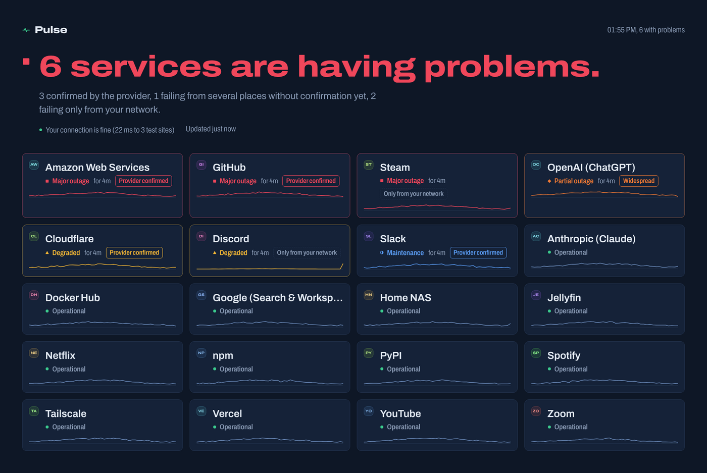

# Pulse: is it down, or is it me?

**Pulse** is a self-hosted outage map and down detector. It watches the services you depend on (GitHub, AWS, Cloudflare, Google, Anthropic, OpenAI, Slack, Discord and ~50 more, including Canadian ISPs such as Bell, TekSavvy and Cogeco, plus your own URLs) using three independent signals:

1. **The provider's official status feed.** Statuspage, AWS Health, Google Cloud, Slack, Apple, status.io, RSS, ISP outage maps… all verified live.
2. **Checks from your network:** HTTP with a DNS/connect/TLS/server timing breakdown, DNS compared against public resolvers, TCP and TLS certificates.
3. **Checks from other places:** optional vantage agents on a VPS or a friend's Raspberry Pi.

It combines them into one honest verdict with the reasons spelled out: **provider confirmed**, **widespread** (before the provider admits it), **only from your network**, or **you're offline**. Then it alerts you through ntfy, Discord, Telegram, email and 80+ others.



| Service detail | Outage map |
|---|---|
|  |  |

| Light theme | Phone | Wall display (`/?kiosk=1`) |
|---|---|---|
|  |  |  |

## 60-second quickstart

```bash
git clone https://github.com/rivarob04/outageDetector.git && cd outageDetector
docker compose -f deploy/docker-compose.yml up -d --build
docker compose -f deploy/docker-compose.yml logs pulse | grep "setup code"
```

Open **http://localhost:8080**, select **Set up admin**, enter the setup code from the logs, then go to **Add services** and watch a few. Checks start immediately.

> Want to look around first? Run with demo data: `PULSE_DEMO=1` (no network calls; everything is fake).
>
> Prefer not to use the setup code? Put `PULSE_ADMIN_USERNAME` and `PULSE_ADMIN_PASSWORD` in `deploy/.env` (copy `deploy/.env.example`).

**Using Dockhand, Portainer or another compose UI?** Use the image-only files in `deploy/dockhand/` and follow [docs/DOCKHAND.md](docs/DOCKHAND.md).

Requirements: Docker with Compose v2. Images are multi-arch (amd64, arm64), so a Raspberry Pi 4/5 works. Pulse uses about 100–150 MB of RAM (see docs/PERFORMANCE.md).

## What you get
- **A verdict sentence**: "GitHub looks partly down for everyone.", with a "Why it's marked …" panel listing every reason.
- **A tile per service**: a shape-coded state (●▲◆■◐○, never color alone), scope badge, latency trace and 90-day bar.
- **A service page**: a timing-breakdown chart, components, provider incident timeline, results from each vantage point and state history.
- **An outage map**: AWS, Google Cloud and Cloudflare regions colored by their status, your agents, and a 24-hour replay. It works offline.
- **Incident history**: time-to-recover per provider and the **lead time** between Pulse spotting a widespread failure and the provider's post.
- **Alerts**: by severity and scope, with quiet hours, cooldown, recovery messages and a daily digest. Alerts pause while you're offline, and you get one summary afterwards.
- **Integrations**: Home Assistant (MQTT discovery), Prometheus `/metrics` + a Grafana dashboard, Atom incident feed, iCal maintenance calendar, SVG badges, and a public `/status` page for family or your team.
- **Your own services**: any URL, homelab included, with keyword and status assertions, guarded against SSRF.
- **Extras**: dark/light/system/high-contrast themes, an installable app (PWA), keyboard shortcuts (`?`) and a kiosk mode.

## Configuration
Everything is optional. Common settings, in `deploy/.env`:

| Variable | What it does |
|---|---|
| `PULSE_BASE_URL` | Your public URL (links in alerts, agent setup) |
| `PULSE_PUBLIC_VIEW=false` | Require sign-in to view |
| `PULSE_ALLOW_PRIVATE_TARGETS=true` | Allow checks of LAN addresses |
| `PULSE_DATABASE_URL` | Use Postgres (`--profile postgres`) |
| `PULSE_MQTT_URL` | Home Assistant via MQTT (`--profile mqtt`) |
| `PULSE_HOST_LOCATION=lat,lon` | Show this hub on the map |
| `PULSE_HOST_PORT` / `PULSE_PORT` | Host and container ports, e.g. `3012` / `3000` for `3012:3000` (both default to 8080) |

The full list is in **[docs/CONFIGURATION.md](docs/CONFIGURATION.md)**.

### Config as code
Drop a `pulse.yaml` into the data volume (`/data/pulse.yaml`) to manage watched services in Git:

```yaml
track: [github, aws, cloudflare, anthropic, openai]
exclusive: false   # true = stop watching catalog services not listed here
custom:
  - id: nas
    name: Home NAS
    category: custom
    probes:
      - {kind: http, url: "http://192.168.1.10:5000", accept_status: [401]}
settings:
  fail_threshold: 3
```

Precedence, highest first: `pulse.yaml` › Settings UI › environment.

## Vantage agents
Run a second copy of Pulse elsewhere as an agent. It checks from that network and reports back over signed HTTPS, and needs no open ports:

```bash
# Settings → Vantage agents → Create agent (copy the token), then on the remote machine:
PULSE_HUB_URL=https://pulse.example.com PULSE_AGENT_TOKEN=... \
  docker compose -f deploy/docker-compose.agent.yml up -d
```

See [docs/AGENTS.md](docs/AGENTS.md). Until a release image is published to GHCR, build it on the agent machine first: `docker build -t ghcr.io/rivarob04/outagedetector:latest .`

## Operating it
| Task | How |
|---|---|
| Logs | `docker compose -f deploy/docker-compose.yml logs -f pulse` |
| Backup | `docker compose -f deploy/docker-compose.yml exec pulse pulse backup /data/backup.tar.gz` (add `--skip-raw` for a small one), or back up the `pulse-data` volume |
| Restore | Stop Pulse, then into an empty data volume containing the file: `docker compose -f deploy/docker-compose.yml run --rm pulse restore /data/backup.tar.gz` (works across SQLite ↔ Postgres) |
| Upgrade | `git pull && docker compose -f deploy/docker-compose.yml up -d --build`. Migrations run automatically on start. |
| Roll back | Take a backup first. Then `pulse migrate --downgrade <revision>` with the new image and start the previous image (see `CHANGELOG.md`). |
| Dockhand / compose UIs | [docs/DOCKHAND.md](docs/DOCKHAND.md) |
| HTTPS / reverse proxy | [docs/REVERSE_PROXY.md](docs/REVERSE_PROXY.md) (Traefik, Caddy, Nginx Proxy Manager, Cloudflare Tunnel, Authelia/Authentik) |

## Documentation
- [How verdicts are decided](docs/verdict.md) · [Advanced signals](docs/SIGNALS.md) · [Alerts and integrations](docs/INTEGRATIONS.md)
- [Configuration](docs/CONFIGURATION.md) · [Security](docs/SECURITY.md) · [Database sizing](docs/DATABASE.md) · [Performance](docs/PERFORMANCE.md)
- [Adding a provider](docs/ADDING_A_PROVIDER.md) · [Catalog verification results](docs/catalog-verification.md) · [FAQ](docs/FAQ.md)
- [Architecture](docs/ARCHITECTURE.md) · [Spec](docs/SPEC.md) · [Roadmap](docs/ROADMAP.md) · [Contributing](CONTRIBUTING.md)

## Development
```bash
make install && make dev-backend   # API on :8080 (PULSE_DEMO=1 for fake data)
make dev-frontend                  # UI on :5173
make test lint                     # pytest (SQLite; CI also runs Postgres) + vitest, ruff, mypy, eslint, tsc
cd frontend && npx playwright test # end-to-end smoke tests against demo mode
```

## License
MIT. Brand names belong to their owners. Pulse uses them only to identify the services it monitors, and isn't affiliated with any of them.
