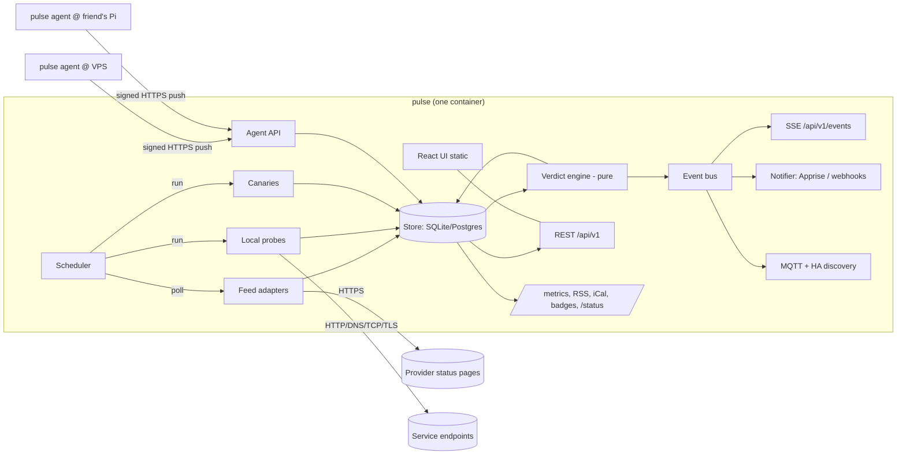

# Architecture



## Components

| Module | Responsibility |
|---|---|
| `pulse/config.py` | Settings from env vars (`PULSE_*`). `*_FILE` variants are supported for secrets. |
| `pulse/http.py` | A shared polite httpx client: UA, timeouts, per-host rate limiting and an ETag/Last-Modified cache. |
| `pulse/catalog/` | Pydantic schema plus a loader for `catalog/*.yaml` and `catalog/regions.yaml`. |
| `pulse/adapters/` | Feed adapters. Each turns the provider's payload into a `FeedSnapshot`. |
| `pulse/probes/` | HTTP, DNS, TCP and TLS probes, canaries and latency baselines. |
| `pulse/verdict/` | A pure engine plus helpers that turn stored data into engine inputs. |
| `pulse/scheduler.py` | An asyncio scheduler: per-job intervals, jitter, bounded concurrency and graceful shutdown. |
| `pulse/db/` | SQLAlchemy Core tables, the engine/session factory, Alembic migrations and the store API. |
| `pulse/api/` | FastAPI routers: public, admin, agent and auth, plus SSE. |
| `pulse/events.py` | An in-process pub/sub bus (asyncio queues). |
| `pulse/notify/` | Rule evaluation, Apprise and webhook delivery, the digest and offline summaries. |
| `pulse/integrations/` | Prometheus metrics, MQTT/HA discovery, RSS/Atom, iCal and SVG badges. |
| `pulse/signals/` | Upstream correlation, anomaly detection, community chatter and lead time (Phase 8). |
| `pulse/agent/` | The agent runtime (`pulse agent`) and the shared signing code. |
| `pulse/demo.py` | Fake data generator for `PULSE_DEMO=1`. |
| `pulse/cli.py` | Typer CLI: `serve`, `agent`, `catalog verify`, `migrate`, `backup`, `restore`, `create-admin`. |

## Data model

| Table | Key fields |
|---|---|
| `services` | `id` (slug PK), `name`, `category`, `source` (`catalog` / `custom`), `tracked` (bool), `config` (JSON: probes and assertions for custom services), `created_at` |
| `components` | `id`, `service_id`, `ext_id`, `name`, `status`, `region` (nullable), `updated_at`; unique (`service_id`, `ext_id`) |
| `incidents` | `id`, `service_id`, `ext_id`, `kind` (`incident` / `maintenance`), `title`, `impact` (`none`/`minor`/`major`/`critical`/`maintenance`), `status`, `url`, `started_at`, `resolved_at`, `scheduled_for`, `scheduled_until`, `components` (JSON), `first_seen_at`, `last_seen_at`; unique (`service_id`, `ext_id`) |
| `incident_updates` | `id`, `incident_id`, `ext_id`, `status`, `body`, `created_at`; unique (`incident_id`, `ext_id`) |
| `feed_status` | `service_id` PK, `indicator`, `description`, `fetched_at`, `ok`, `error` |
| `probes` | `id` (e.g. `github:http:0`), `service_id`, `kind`, `target`, `config` (JSON), `enabled` |
| `probe_results` | `id`, `probe_id`, `agent_id` (null = this hub), `ts`, `ok`, `latency_ms`, `dns_ms`, `connect_ms`, `tls_ms`, `ttfb_ms`, `status_code`, `error`, `detail` (JSON) |
| `rollups` | `probe_id`, `agent_id`, `res` (`5m` / `1d`), `bucket`, `n`, `n_ok`, `avg_ms`, `p50_ms`, `p95_ms`; PK (`probe_id`, `agent_id`, `res`, `bucket`) |
| `service_state` | `service_id` PK, `state`, `scope`, `reasons` (JSON), `advisories` (JSON), `since`, `updated_at`, `pending_state`, `pending_count` |
| `state_transitions` | `id`, `service_id`, `from_state`, `to_state`, `scope`, `reasons`, `ts` |
| `agents` | `id`, `name`, `location`, `lat`, `lon`, `created_at`, `last_seen_at`, `revoked` |
| `agent_nonces` | `nonce` PK, `ts` (pruned after 10 minutes) |
| `users` | `id`, `username`, `password_hash` (scrypt), `created_at` |
| `settings` | `key` PK, `value` (JSON) |
| `notify_channels` | `id`, `name`, `kind` (`apprise` / `webhook`), `url`, `secret`, `enabled` |
| `notify_rules` | `id`, `channel_id`, `services` (JSON), `categories` (JSON), `min_state`, `scopes` (JSON), `quiet_start`, `quiet_end`, `tz`, `cooldown_s`, `recovery`, `digest` |
| `notify_log` | `id`, `channel_id`, `service_id`, `kind`, `ts`, `ok`, `error` |
| `chatter` | `service_id`, `source`, `bucket`, `count` (Phase 8) |

Regions (`aws:us-east-1`, `cf:YYZ`, …) are static data in `catalog/regions.yaml` (`id`, `name`, `provider`, `lat`, `lon`), not a table.

## Scheduler

- A single asyncio task holds a min-heap of `(next_run, job)`. Each job has an `interval` and `jitter` (default ±10%) and runs under a global semaphore (default 20 concurrent).
- **Jobs:** `feed:<service>` (60 s), `probe:<probe_id>` (60 s), `canary` (30 s), `verdict` (event-driven, plus every 30 s as a safety net), `rollup` (5 min), `retention` (1 h), `agent-stale` (1 min), `digest` (daily at a configured time), `chatter` (10 min, Phase 8).
- A failing job is logged and rescheduled, and is never allowed to kill the loop. Backoff doubles the interval up to 10× after consecutive errors.
- Tracking or untracking a service adds or removes its jobs live.

## Adapter interface

```python
class Adapter(Protocol):
    kind: ClassVar[str]                       # "statuspage", "aws", ...
    async def fetch(self, client: PoliteClient, feed: FeedConfig) -> FeedSnapshot: ...
```
- `FeedSnapshot`: `indicator` (`none|minor|major|critical|maintenance`), `description`, `components[]` (`ext_id`, `name`, `status`, `region?`), `incidents[]` (`ext_id`, `kind`, `title`, `impact`, `status`, `url`, `started_at`, `resolved_at?`, `scheduled_for?`, `scheduled_until?`, `component_ids[]`, `updates[]`).
- Adapters must be pure parsers apart from the fetch, so that `parse(bytes) -> FeedSnapshot` can be tested against fixtures.
- Component filtering (e.g. Apple: iCloud components only) happens through `feed.components_include` regexes in the catalog.

## Probe interface

```python
async def run_probe(spec: ProbeSpec, ctx: ProbeContext) -> ProbeResult
```
`ProbeSpec.kind` is one of `http | dns | tcp | tls`. `ProbeResult` has `ok`, `latency_ms`, a timing breakdown, `status_code`, `error` (a classified enum: `dns`, `connect`, `tls`, `timeout`, `http_status`, `assertion`, `ssrf_blocked`), and `detail`. The same code runs on the hub and on agents.

## Verdict engine

`evaluate(inputs: VerdictInputs, prev: PrevState, cfg: VerdictConfig, now: datetime) -> Verdict`

- **Inputs:** a feed signal (indicator, active incidents/maintenance, freshness), a local probe signal (per-probe consecutive failures, latency anomaly, DNS-vs-public-resolver result), vantage signals (fresh agents, each ok/failing/degraded), `local_network`, and upstream advisories.
- **Output:** `state`, `scope`, `reasons[]` (human-readable), `advisories[]`, `pending_state` and `pending_count` (flap protection).
- The full decision table is in `docs/verdict.md`.

## Live updates (SSE)

`/api/v1/events` streams `event: state` (a service changed state or scope), `event: incident` (new incident or update), `event: connectivity` (canary flip) and `event: ping` (every 15 s keepalive). The UI keeps one EventSource and patches its in-memory store from these events. On reconnect it refetches `/api/v1/summary`.

## Agent push protocol

1. An admin creates an agent in the UI. The hub returns a token `"<agent_id>.<secret>"` where `secret = hex(HMAC_SHA256(SECRET_KEY, "agent:" + agent_id))`. It is shown once and is not stored.
2. The agent calls `GET /api/v1/agent/probes` (the list of probe specs for tracked services; HTTP/DNS/TCP/TLS only, with custom private targets excluded) and `POST /api/v1/agent/results` (a batch of `ProbeResult`s).
3. Every request carries `X-Pulse-Agent: <id>`, `X-Pulse-Timestamp: <unix>`, `X-Pulse-Nonce: <random 16B hex>` and `X-Pulse-Signature: hex(HMAC_SHA256(secret, ts + "\n" + nonce + "\n" + METHOD + "\n" + path + "\n" + sha256hex(body)))`.
4. The hub rejects requests when the timestamp skew is over 300 s, the nonce has been seen before (stored for 10 minutes), the agent is revoked, or the signature doesn't match (constant-time compare).
5. An agent is **stale** when it hasn't been seen for 3 × its push interval. Stale agents are excluded from verdicts.
6. Agents never accept inbound connections.

## Retention and rollups

- `rollup` aggregates finished 5-minute buckets from `probe_results` into `rollups(res='5m')`, and finished days into `rollups(res='1d')`. Percentiles are computed in Python per bucket so the SQL stays portable.
- `retention` deletes raw `probe_results` older than `PULSE_RETENTION_RAW_DAYS` (7), 5-minute rollups older than `PULSE_RETENTION_5M_DAYS` (90), resolved incidents older than `PULSE_RETENTION_INCIDENT_DAYS` (365), and old state transitions and notification logs. Daily rollups are kept forever.
- SQLite runs with `journal_mode=WAL`, `synchronous=NORMAL`, plus a weekly `VACUUM`-free `PRAGMA incremental_vacuum` (auto_vacuum=INCREMENTAL).

## Security model (summary; full version in docs/SECURITY.md)
- Viewing is public or private (`PULSE_PUBLIC_VIEW`). Mutations always need an admin session (signed cookie with SameSite=Lax) plus the `X-CSRF-Token` header, or a trusted auth header from an allow-listed proxy.
- Custom probe targets go through an SSRF guard. The hostname is resolved first; private, loopback, link-local, metadata and CGNAT ranges are blocked unless `PULSE_ALLOW_PRIVATE_TARGETS=true`.
- The container runs as UID 10001 with a read-only rootfs (the `/data` volume is writable), `cap_drop: [ALL]` and `no-new-privileges`.
